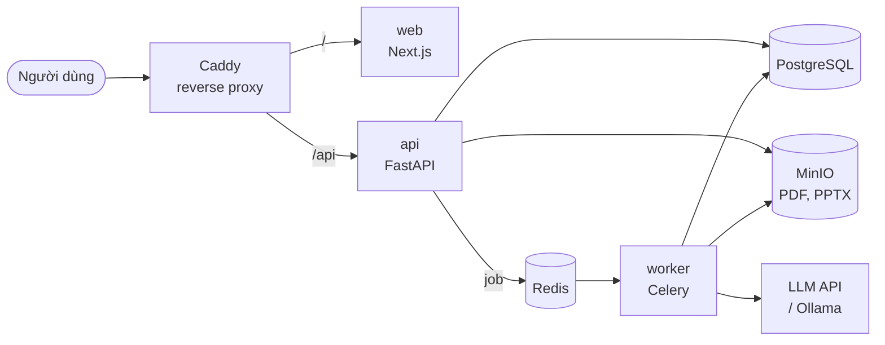

<h1 align="center">Stugen</h1>

<p align="center">
  <b>Biến giáo trình PDF thành tóm tắt, slide và quiz ôn tập — bằng AI.</b>
</p>

<p align="center">
  
  
  
  
  
</p>

---

**Stugen** là website phi thương mại giúp sinh viên và người tự học ôn tập nhanh hơn. Người dùng đăng nhập bằng tài khoản Google, tải lên giáo trình PDF và nhận về:

- 📝 **Tóm tắt** theo chương — ý chính, thuật ngữ kèm định nghĩa, số trang tham chiếu tới PDF gốc, hỗ trợ công thức toán.
- 📊 **Slide** trình chiếu — xem trực tuyến hoặc tải về dạng **PPTX**.
- ✅ **Quiz** trắc nghiệm 4 lựa chọn (10 / 20 / 30 câu) — chấm điểm, giải thích, lưu lịch sử làm bài.

Mọi bài giảng được lưu trong **thư viện cá nhân** theo tài khoản để xem lại sau.

> [!NOTE]
> Repository hiện chứa **tài liệu thiết kế** (PRD, ADR, mô hình dữ liệu, API). Mã nguồn sẽ được bổ sung theo [kế hoạch phát triển](docs/plans/plan-1-ngay.md).

## Kiến trúc



- **Frontend và API cùng domain** qua Caddy; xác thực bằng cookie phiên `HttpOnly` do backend cấp.
- **Tác vụ chậm** (trích xuất PDF, gọi LLM, xuất PPTX) chạy trong Celery worker; frontend theo dõi tiến trình bằng polling.
- **LLM xử lý theo chương** (map–reduce), đầu ra JSON được kiểm tra bằng Pydantic trước khi lưu.

Chi tiết: [ADR-0002](docs/adr/0002-kien-truc-tong-the.md).

## Công nghệ

| Thành phần | Công nghệ |
|---|---|
| Frontend | Next.js (App Router), TypeScript, Tailwind CSS, shadcn/ui, TanStack Query, Reveal.js, react-pdf, KaTeX |
| Backend API | Python 3.12, FastAPI, SQLAlchemy 2.0, Alembic, Authlib (Google OAuth) |
| AI Worker | Celery, PyMuPDF, python-pptx, Pydantic, LLM API (Anthropic / OpenAI / Ollama) |
| Hạ tầng | PostgreSQL 16, Redis 7, MinIO, Caddy, Docker Compose |

## Tài liệu

| Tài liệu | Nội dung |
|---|---|
| [PRD](docs/product/PRD.md) | Sản phẩm làm gì, phạm vi, chức năng, tiêu chí hoàn thành |
| [ADR](docs/adr/README.md) | 14 quyết định kiến trúc và lý do lựa chọn |
| [Mô hình dữ liệu](docs/design/data-model.md) | ERD, chi tiết bảng, cấu trúc JSONB, vòng đời trạng thái, DDL |
| [Tài liệu API](docs/design/api.md) | Hợp đồng REST giữa frontend và backend, mã lỗi |
| [Kế hoạch 1 ngày](docs/plans/plan-1-ngay.md) | Lịch phát triển MVP theo từng khối |
| [CLAUDE.md](CLAUDE.md) | Quy tắc code và quy trình khi làm việc với Claude Code |

**Thứ tự đọc đề xuất:** PRD → ADR → Mô hình dữ liệu → API.

## Cấu trúc repository

```
Stugen/
├── README.md
├── CLAUDE.md                  # Hướng dẫn cho Claude Code
├── .env.example               # Mẫu biến môi trường
└── docs/
    ├── product/
    │   └── PRD.md             # Yêu cầu sản phẩm
    ├── design/
    │   ├── data-model.md      # Mô hình dữ liệu
    │   └── api.md             # Tài liệu REST API
    ├── adr/                   # Architecture Decision Records
    │   ├── README.md          # Mục lục ADR
    │   ├── template.md        # Mẫu ADR mới
    │   └── 0001 … 0014-*.md
    └── plans/
        └── plan-1-ngay.md     # Kế hoạch phát triển
```

Khi bắt đầu viết code, repository sẽ có thêm `frontend/`, `backend/`, `docker-compose.yml`, `Caddyfile` và `Makefile` (xem [CLAUDE.md](CLAUDE.md)).

## Chạy dự án *(sau khi có mã nguồn)*

```bash
cp .env.example .env      # điền Google OAuth, LLM API key, mật khẩu DB/MinIO
make up                   # docker compose up -d --build
make migrate              # alembic upgrade head
```

- Ứng dụng: <http://localhost>
- Tài liệu API (OpenAPI): <http://localhost/api/docs>
- MinIO console: <http://localhost:9001>

Yêu cầu: Docker Desktop, Node 22, Python 3.12, OAuth Client trên Google Cloud Console với redirect URI `http://localhost/api/auth/google/callback`.

## Quy ước

- Tài liệu viết bằng Markdown, sơ đồ bằng Mermaid.
- Thay đổi kiến trúc → thêm ADR mới theo [`docs/adr/template.md`](docs/adr/template.md); không sửa ADR đã chấp nhận.
- Thay đổi lược đồ hoặc API → cập nhật `docs/design/data-model.md` / `docs/design/api.md` trong cùng pull request với code.
- Commit theo [Conventional Commits](https://www.conventionalcommits.org/): `feat(api): ...`, `fix(worker): ...`, `docs: ...`.

## Phiên bản tài liệu

| Tài liệu | Phiên bản | Ngày |
|---|---|---|
| PRD | 2.1 | 18/10/2026 |
| ADR | 0001–0014 | 18/10/2026 |
| Mô hình dữ liệu | 1.0 | 18/10/2026 |
| Tài liệu API | 1.0 | 18/10/2026 |

## Giấy phép

Chưa chọn giấy phép. Lưu ý: PyMuPDF dùng giấy phép **AGPL** (xem [ADR-0009](docs/adr/0009-trich-xuat-pdf-pymupdf.md)).
