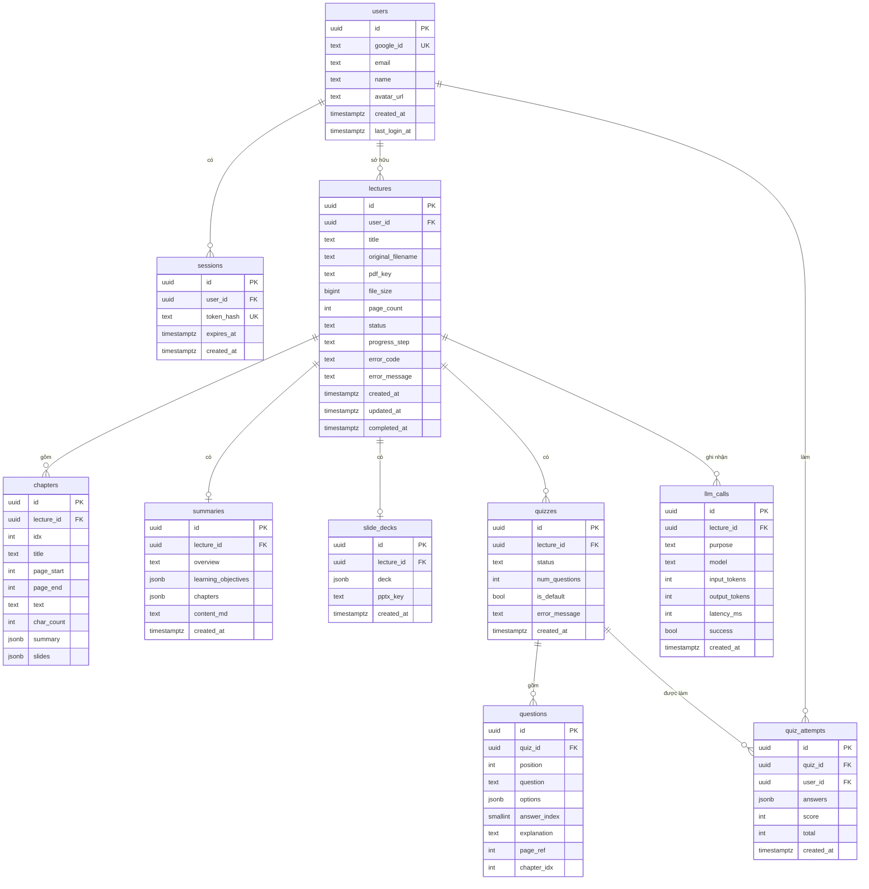
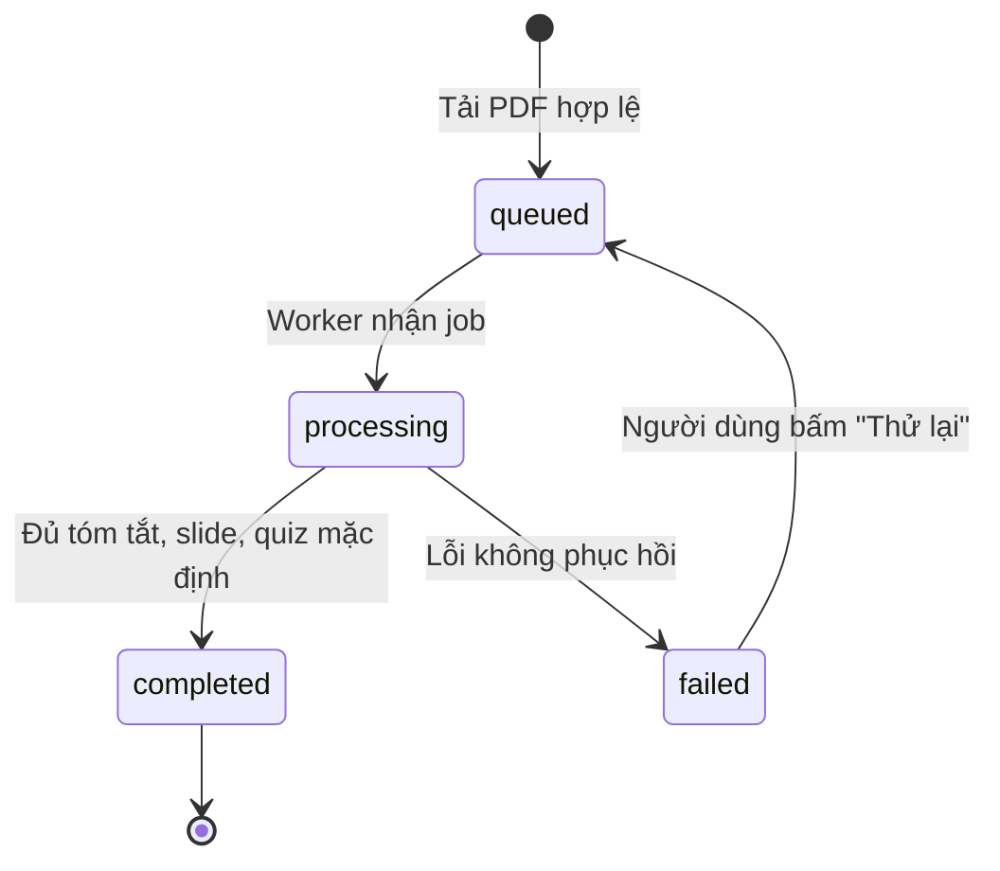

# Mô hình dữ liệu

> Phiên bản 1.2 · Dựa trên [PRD v2.3](../product/PRD.md) và [ADR](../adr/README.md) 0005, 0006, 0007, 0010, 0011, 0012, 0015, 0016 · Cập nhật 19/10/2026
>
> Đây là **nguồn chuẩn** cho lược đồ CSDL; lược đồ trong ADR-0006 chỉ là bản phác thảo.
>
> Migration đầu tiên (`backend/alembic/versions/*_initial_schema.py`) tạo đúng mục 9, trừ `llm_calls`. Tên ràng buộc theo quy ước `pk_/uq_/ck_/fk_<bảng>_...`.

## 1. Tổng quan

- **CSDL:** PostgreSQL 16, truy cập qua SQLAlchemy 2.0, migration bằng Alembic.
- **Khoá chính:** UUID v4, sinh phía ứng dụng.
- **Thời gian:** `TIMESTAMPTZ`, lưu UTC, API trả ISO 8601.
- **Xoá:** xoá cứng (hard delete), dùng `ON DELETE CASCADE` để xoá dây chuyền.
- **Dữ liệu bán cấu trúc:** `JSONB`, luôn validate bằng Pydantic trước khi ghi.
- **File nhị phân:** lưu ở MinIO, DB chỉ lưu object key.

## 2. Sơ đồ quan hệ



## 3. Chi tiết các bảng

### 3.1 `users`
Một bản ghi cho mỗi tài khoản Google.

| Cột | Kiểu | Ràng buộc | Mô tả |
|---|---|---|---|
| `id` | UUID | PK | |
| `google_id` | TEXT | NOT NULL, UNIQUE | Claim `sub` của Google, định danh bất biến |
| `email` | TEXT | NOT NULL | Cập nhật mỗi lần đăng nhập |
| `name` | TEXT | NOT NULL | |
| `avatar_url` | TEXT | NULL | |
| `created_at` | TIMESTAMPTZ | NOT NULL, DEFAULT now() | |
| `last_login_at` | TIMESTAMPTZ | NOT NULL | |

Định danh người dùng theo `google_id`, không theo `email` (email có thể đổi).

### 3.2 `sessions`
Phiên đăng nhập (ADR-0005).

| Cột | Kiểu | Ràng buộc | Mô tả |
|---|---|---|---|
| `id` | UUID | PK | |
| `user_id` | UUID | FK → users, CASCADE | |
| `token_hash` | TEXT | NOT NULL, UNIQUE | SHA-256 (hex) của token trong cookie `sid` |
| `expires_at` | TIMESTAMPTZ | NOT NULL | Sliding 7 ngày |
| `created_at` | TIMESTAMPTZ | NOT NULL | |

Index: `(expires_at)` cho tác vụ dọn phiên hết hạn.

### 3.3 `lectures`
Một bài giảng ứng với một file PDF được tải lên.

| Cột | Kiểu | Ràng buộc | Mô tả |
|---|---|---|---|
| `id` | UUID | PK | |
| `user_id` | UUID | FK → users, CASCADE | Chủ sở hữu |
| `title` | TEXT | NOT NULL, 1–200 ký tự | Mặc định: tên file bỏ đuôi `.pdf` hoặc metadata title của PDF |
| `original_filename` | TEXT | NOT NULL | |
| `pdf_key` | TEXT | NOT NULL | Object key trong MinIO |
| `file_size` | BIGINT | NOT NULL, ≤ 20 MB | Byte |
| `page_count` | INT | NOT NULL, 1–200 | |
| `status` | TEXT | NOT NULL, CHECK | `queued` · `processing` · `completed` · `failed` |
| `progress_step` | TEXT | NULL, CHECK | `extracting` · `summarizing` · `slides` · `quiz` |
| `error_code` | TEXT | NULL | Mã lỗi máy đọc, ví dụ `PDF_NO_TEXT` |
| `error_message` | TEXT | NULL | Thông điệp tiếng Việt hiển thị cho người dùng |
| `created_at` | TIMESTAMPTZ | NOT NULL | |
| `updated_at` | TIMESTAMPTZ | NOT NULL | Cập nhật mỗi khi đổi trạng thái/tên |
| `completed_at` | TIMESTAMPTZ | NULL | |

Index:
- `(user_id, created_at DESC)` – danh sách thư viện.
- GIN trigram trên `title` (extension `pg_trgm`) – tìm kiếm theo tên.

### 3.4 `chapters`
Kết quả trích xuất PDF đã chia chương (ADR-0009). Dùng lại khi sinh quiz mới.

| Cột | Kiểu | Ràng buộc | Mô tả |
|---|---|---|---|
| `id` | UUID | PK | |
| `lecture_id` | UUID | FK → lectures, CASCADE | |
| `idx` | INT | NOT NULL, ≥ 0 | Thứ tự chương |
| `title` | TEXT | NOT NULL | |
| `page_start` | INT | NOT NULL | Bắt đầu từ 1 |
| `page_end` | INT | NOT NULL, ≥ page_start | |
| `text` | TEXT | NOT NULL | Có đánh dấu `[[trang N]]` |
| `char_count` | INT | NOT NULL | Dùng để phân bổ số câu hỏi |
| `summary` | JSONB | NULL | `ChapterSummaryLLM` của chương, ghi ngay khi xong (ADR-0015) |
| `slides` | JSONB | NULL | Danh sách slide `bullets` của chương, ghi ngay khi xong (ADR-0015) |

Unique: `(lecture_id, idx)`.

`summary` và `slides` là kết quả trung gian để chạy lại không gọi lại LLM cho chương đã xong: chương nào đã có giá trị thì bỏ qua. Khi đủ các chương, code lắp ráp `summaries` và `slide_decks` từ hai cột này.

### 3.5 `summaries`
Tóm tắt của một bài giảng (1–1).

| Cột | Kiểu | Ràng buộc | Mô tả |
|---|---|---|---|
| `id` | UUID | PK | |
| `lecture_id` | UUID | FK → lectures, CASCADE, UNIQUE | |
| `overview` | TEXT | NOT NULL | Đoạn tổng quan |
| `learning_objectives` | JSONB | NOT NULL | `string[]`, tối đa 6 mục, mỗi mục ≤ 120 ký tự (dùng làm slide tổng kết) |
| `chapters` | JSONB | NOT NULL | `ChapterSummary[]`, xem 4.1 |
| `content_md` | TEXT | NOT NULL | Markdown lắp ráp từ các trường trên |
| `created_at` | TIMESTAMPTZ | NOT NULL | |

### 3.6 `slide_decks`
Bộ slide của một bài giảng (1–1, ADR-0011).

| Cột | Kiểu | Ràng buộc | Mô tả |
|---|---|---|---|
| `id` | UUID | PK | |
| `lecture_id` | UUID | FK → lectures, CASCADE, UNIQUE | |
| `deck` | JSONB | NOT NULL | `SlideDeck`, xem 4.2 |
| `pptx_key` | TEXT | NULL | NULL nếu xuất PPTX thất bại |
| `created_at` | TIMESTAMPTZ | NOT NULL | |

### 3.7 `quizzes`
Một lần sinh bộ câu hỏi. Mỗi bài giảng có 1 quiz mặc định và có thể có thêm nhiều quiz (ADR-0012).

| Cột | Kiểu | Ràng buộc | Mô tả |
|---|---|---|---|
| `id` | UUID | PK | |
| `lecture_id` | UUID | FK → lectures, CASCADE | |
| `status` | TEXT | NOT NULL, CHECK | `queued` · `processing` · `completed` · `failed` |
| `num_questions` | INT | NOT NULL, IN (10, 20, 30) | |
| `is_default` | BOOLEAN | NOT NULL, DEFAULT false | Quiz sinh tự động khi xử lý bài giảng |
| `error_message` | TEXT | NULL | |
| `created_at` | TIMESTAMPTZ | NOT NULL | |

Index: `(lecture_id, created_at DESC)`.

### 3.8 `questions`

| Cột | Kiểu | Ràng buộc | Mô tả |
|---|---|---|---|
| `id` | UUID | PK | |
| `quiz_id` | UUID | FK → quizzes, CASCADE | |
| `position` | INT | NOT NULL | Thứ tự hiển thị, bắt đầu từ 1 |
| `question` | TEXT | NOT NULL | |
| `options` | JSONB | NOT NULL | Mảng đúng 4 chuỗi, đã xáo trộn |
| `answer_index` | SMALLINT | NOT NULL, 0–3 | **Không bao giờ trả về trước khi nộp bài** |
| `explanation` | TEXT | NOT NULL | |
| `page_ref` | INT | NOT NULL | Trang tham chiếu trong PDF |
| `chapter_idx` | INT | NOT NULL | Chương nguồn |

Unique: `(quiz_id, position)`.

### 3.9 `quiz_attempts`
Một lần làm bài.

| Cột | Kiểu | Ràng buộc | Mô tả |
|---|---|---|---|
| `id` | UUID | PK | |
| `quiz_id` | UUID | FK → quizzes, CASCADE | |
| `user_id` | UUID | FK → users, CASCADE | |
| `answers` | JSONB | NOT NULL | `{ "<question_id>": 0..3 \| null }` |
| `score` | INT | NOT NULL | Số câu đúng |
| `total` | INT | NOT NULL | Tổng số câu |
| `created_at` | TIMESTAMPTZ | NOT NULL | Thời điểm nộp |

Index: `(quiz_id, created_at DESC)`.

### 3.10 `llm_calls` (nội bộ)
Nhật ký gọi LLM để theo dõi chi phí (ADR-0010). Không lộ qua API.

> **Chưa tạo ở v0.1.0** (kế hoạch để sau). Hiện số token vào/ra được ghi vào log có cấu trúc của worker (`LLM call model=... in=... out=...`).

| Cột | Kiểu | Mô tả |
|---|---|---|
| `id` | UUID | PK |
| `lecture_id` | UUID | FK → lectures, SET NULL |
| `purpose` | TEXT | `chapter_summary` · `overview` · `slides` · `quiz` |
| `model` | TEXT | |
| `input_tokens`, `output_tokens` | INT | |
| `latency_ms` | INT | |
| `success` | BOOLEAN | |
| `created_at` | TIMESTAMPTZ | |

## 4. Cấu trúc JSONB

### 4.1 `summaries.chapters` – `ChapterSummary[]`

LLM chỉ sinh `key_points` (1–8 mục) và `terms` (≤ 10 mục) – lưu ở `chapters.summary`. Các trường `idx`, `title`, `page_start`, `page_end` do code ghép từ bảng `chapters` (ADR-0015), LLM không trả số trang chương.

```json
[
  {
    "idx": 0,
    "title": "Chương 1. Tổng quan về cơ sở dữ liệu",
    "key_points": [
      "Cơ sở dữ liệu là tập hợp dữ liệu có tổ chức, được chia sẻ cho nhiều người dùng.",
      "Hệ quản trị CSDL cung cấp cơ chế lưu trữ, truy xuất và bảo mật dữ liệu."
    ],
    "terms": [
      { "term": "DBMS", "definition": "Phần mềm quản lý và truy xuất cơ sở dữ liệu." }
    ],
    "page_start": 1,
    "page_end": 18
  }
]
```

### 4.2 `slide_decks.deck` – `SlideDeck`
```json
{
  "version": 1,
  "title": "Nhập môn Cơ sở dữ liệu",
  "slides": [
    { "layout": "title", "title": "Nhập môn Cơ sở dữ liệu", "subtitle": "Tóm lược giáo trình" },
    { "layout": "agenda", "title": "Nội dung", "bullets": ["Tổng quan", "Mô hình quan hệ"] },
    { "layout": "section", "title": "Chương 1. Tổng quan" },
    {
      "layout": "bullets",
      "title": "Hệ quản trị CSDL",
      "bullets": ["Lưu trữ và truy xuất dữ liệu", "Đảm bảo toàn vẹn và bảo mật"],
      "notes": "Nhấn mạnh vai trò trung gian giữa người dùng và dữ liệu.",
      "page_refs": [5, 6]
    },
    { "layout": "summary", "title": "Tổng kết", "bullets": ["..."] }
  ]
}
```

| Trường | Ràng buộc |
|---|---|
| `layout` | `title` · `agenda` · `section` · `bullets` · `summary` |
| `title` | ≤ 80 ký tự |
| `bullets` | ≤ 6 phần tử, mỗi phần tử ≤ 120 ký tự |
| `notes`, `subtitle`, `page_refs` | Tuỳ chọn |

### 4.3 `questions.options`
```json
["Khoá chính", "Khoá ngoại", "Chỉ mục", "Ràng buộc CHECK"]
```

### 4.4 `quiz_attempts.answers`
```json
{
  "7b1e...": 2,
  "c09a...": null
}
```
`null` nghĩa là bỏ trống, tính là sai.

## 5. Vòng đời trạng thái

### 5.1 `lectures.status`


Khi `processing`, `progress_step` lần lượt là `extracting → summarizing → slides → quiz`. Khi kết thúc (`completed`/`failed`), `progress_step` giữ bước cuối cùng đã chạy để biết lỗi ở đâu.

Dữ liệu sẵn có theo bước:

| `progress_step` đã qua | Dữ liệu đọc được |
|---|---|
| `extracting` | `chapters` |
| `summarizing` | `summaries` |
| `slides` | `slide_decks` |
| `quiz` | quiz mặc định |

### 5.2 `quizzes.status`
`queued → processing → completed | failed`. Quiz `failed` có thể xoá hoặc tạo quiz mới; không có thử lại riêng.

## 6. Mã lỗi xử lý (`lectures.error_code`)

| Mã | Ý nghĩa | Thông điệp hiển thị |
|---|---|---|
| `PDF_NO_TEXT` | PDF scan, không có lớp văn bản | Giáo trình có vẻ là bản scan, hiện chưa được hỗ trợ. |
| `PDF_CORRUPTED` | Không đọc được PDF trong worker | Không đọc được file PDF. |
| `LLM_UNAVAILABLE` | Lỗi mạng/quá tải sau khi thử lại | Dịch vụ AI tạm thời gián đoạn, vui lòng thử lại sau. |
| `LLM_INVALID_OUTPUT` | Đầu ra sai định dạng sau khi thử lại | Không tạo được nội dung, vui lòng thử lại. |
| `TIMEOUT` | Vượt quá thời gian xử lý | Xử lý quá lâu, vui lòng thử lại. |
| `INTERNAL` | Lỗi khác | Đã xảy ra lỗi, vui lòng thử lại. |

## 7. Lưu trữ file (MinIO)

Bucket riêng tư `stugen` (ADR-0016):

```
users/{user_id}/lectures/{lecture_id}/source.pdf
users/{user_id}/lectures/{lecture_id}/slides.pptx
```

Xoá bài giảng → xoá bản ghi DB → xoá prefix `users/{user_id}/lectures/{lecture_id}/`.

## 8. Quy tắc xoá

| Hành động | Bị xoá theo |
|---|---|
| Xoá bài giảng | chapters, summaries, slide_decks, quizzes → questions, quiz_attempts; file trên MinIO. `llm_calls.lecture_id` đặt NULL |
| Xoá quiz | questions, quiz_attempts |
| Đăng xuất | Bản ghi `sessions` tương ứng |
| Tác vụ dọn dẹp hằng ngày | `sessions` hết hạn; object MinIO không còn `lecture` tương ứng |

## 9. Phụ lục: DDL tham khảo

```sql
CREATE EXTENSION IF NOT EXISTS pg_trgm;

CREATE TABLE users (
  id            UUID PRIMARY KEY,
  google_id     TEXT NOT NULL UNIQUE,
  email         TEXT NOT NULL,
  name          TEXT NOT NULL,
  avatar_url    TEXT,
  created_at    TIMESTAMPTZ NOT NULL DEFAULT now(),
  last_login_at TIMESTAMPTZ NOT NULL DEFAULT now()
);

CREATE TABLE sessions (
  id         UUID PRIMARY KEY,
  user_id    UUID NOT NULL REFERENCES users(id) ON DELETE CASCADE,
  token_hash TEXT NOT NULL UNIQUE,
  expires_at TIMESTAMPTZ NOT NULL,
  created_at TIMESTAMPTZ NOT NULL DEFAULT now()
);
CREATE INDEX ix_sessions_expires_at ON sessions(expires_at);

CREATE TABLE lectures (
  id                UUID PRIMARY KEY,
  user_id           UUID NOT NULL REFERENCES users(id) ON DELETE CASCADE,
  title             TEXT NOT NULL CHECK (char_length(title) BETWEEN 1 AND 200),
  original_filename TEXT NOT NULL,
  pdf_key           TEXT NOT NULL,
  file_size         BIGINT NOT NULL CHECK (file_size <= 20971520),
  page_count        INT NOT NULL CHECK (page_count BETWEEN 1 AND 200),
  status            TEXT NOT NULL DEFAULT 'queued'
                    CHECK (status IN ('queued','processing','completed','failed')),
  progress_step     TEXT CHECK (progress_step IN ('extracting','summarizing','slides','quiz')),
  error_code        TEXT,
  error_message     TEXT,
  created_at        TIMESTAMPTZ NOT NULL DEFAULT now(),
  updated_at        TIMESTAMPTZ NOT NULL DEFAULT now(),
  completed_at      TIMESTAMPTZ
);
CREATE INDEX ix_lectures_user_created ON lectures(user_id, created_at DESC);
CREATE INDEX ix_lectures_title_trgm ON lectures USING gin (title gin_trgm_ops);

CREATE TABLE chapters (
  id         UUID PRIMARY KEY,
  lecture_id UUID NOT NULL REFERENCES lectures(id) ON DELETE CASCADE,
  idx        INT NOT NULL CHECK (idx >= 0),
  title      TEXT NOT NULL,
  page_start INT NOT NULL,
  page_end   INT NOT NULL CHECK (page_end >= page_start),
  text       TEXT NOT NULL,
  char_count INT NOT NULL,
  summary    JSONB,
  slides     JSONB,
  UNIQUE (lecture_id, idx)
);

CREATE TABLE summaries (
  id                  UUID PRIMARY KEY,
  lecture_id          UUID NOT NULL UNIQUE REFERENCES lectures(id) ON DELETE CASCADE,
  overview            TEXT NOT NULL,
  learning_objectives JSONB NOT NULL,
  chapters            JSONB NOT NULL,
  content_md          TEXT NOT NULL,
  created_at          TIMESTAMPTZ NOT NULL DEFAULT now()
);

CREATE TABLE slide_decks (
  id         UUID PRIMARY KEY,
  lecture_id UUID NOT NULL UNIQUE REFERENCES lectures(id) ON DELETE CASCADE,
  deck       JSONB NOT NULL,
  pptx_key   TEXT,
  created_at TIMESTAMPTZ NOT NULL DEFAULT now()
);

CREATE TABLE quizzes (
  id            UUID PRIMARY KEY,
  lecture_id    UUID NOT NULL REFERENCES lectures(id) ON DELETE CASCADE,
  status        TEXT NOT NULL DEFAULT 'queued'
                CHECK (status IN ('queued','processing','completed','failed')),
  num_questions INT NOT NULL CHECK (num_questions IN (10, 20, 30)),
  is_default    BOOLEAN NOT NULL DEFAULT false,
  error_message TEXT,
  created_at    TIMESTAMPTZ NOT NULL DEFAULT now()
);
CREATE INDEX ix_quizzes_lecture_created ON quizzes(lecture_id, created_at DESC);

CREATE TABLE questions (
  id           UUID PRIMARY KEY,
  quiz_id      UUID NOT NULL REFERENCES quizzes(id) ON DELETE CASCADE,
  position     INT NOT NULL,
  question     TEXT NOT NULL,
  options      JSONB NOT NULL CHECK (jsonb_array_length(options) = 4),
  answer_index SMALLINT NOT NULL CHECK (answer_index BETWEEN 0 AND 3),
  explanation  TEXT NOT NULL,
  page_ref     INT NOT NULL,
  chapter_idx  INT NOT NULL,
  UNIQUE (quiz_id, position)
);

CREATE TABLE quiz_attempts (
  id         UUID PRIMARY KEY,
  quiz_id    UUID NOT NULL REFERENCES quizzes(id) ON DELETE CASCADE,
  user_id    UUID NOT NULL REFERENCES users(id) ON DELETE CASCADE,
  answers    JSONB NOT NULL,
  score      INT NOT NULL CHECK (score >= 0),
  total      INT NOT NULL CHECK (total > 0),
  created_at TIMESTAMPTZ NOT NULL DEFAULT now()
);
CREATE INDEX ix_attempts_quiz_created ON quiz_attempts(quiz_id, created_at DESC);

CREATE TABLE llm_calls (
  id            UUID PRIMARY KEY,
  lecture_id    UUID REFERENCES lectures(id) ON DELETE SET NULL,
  purpose       TEXT NOT NULL,
  model         TEXT NOT NULL,
  input_tokens  INT,
  output_tokens INT,
  latency_ms    INT,
  success       BOOLEAN NOT NULL,
  created_at    TIMESTAMPTZ NOT NULL DEFAULT now()
);
```
